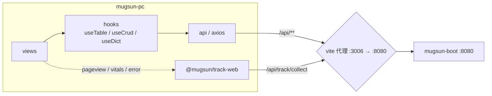

# mugsun-pc

[English](./README_EN.md) | 简体中文

mugsun 平台的 PC 管理前端。面向需要自建后台的团队，用 Vue 3 + TypeScript + Vite + Element Plus 对接 [mugsun-boot](https://github.com/mugsun/mugsun-boot)：菜单与按钮权限由服务端下发，系统管理、低代码表单、工作流、监控、开放平台与租户运营开箱可用；GIS / 埋点看板 / AI 助手以可选模块挂载，不是「大而全低代码」营销壳。

文档：[docs.mugsun.com](https://docs.mugsun.com/) · 站点：[mugsun.com](https://mugsun.com)

[](https://vuejs.org/)
[](https://www.typescriptlang.org/)
[](https://vite.dev/)
[](https://element-plus.org/)
[](https://pnpm.io/)
[](./LICENSE)

## 功能（以源码为准）

| 能力 | 说明 |
| --- | --- |
| 服务端菜单与权限 | `VITE_ACCESS_MODE=backend`：侧边栏来自后端菜单树；`v-perm` / `hasPerm` 按 `/auth/info` 按钮码门控 |
| CRUD 组合式 | `useTable` / `useCrud` / `useDict`、表格列持久化（`src/hooks/core`） |
| 低代码表单 | `@form-create/designer` + `@form-create/element-ui`（表单设计器页与流程审批表单） |
| 工作流 | 流程定义 / 待办 / 流转 / 图形（`src/views/system/flow-*`） |
| 监控与开放平台 | 在线用户、缓存、各类日志；OAuth 客户端 / 同意 / 调试；API Key 等 |
| 租户运营 | 租户、套餐、数据源（`tenant*`） |
| 自监控埋点 | 可选模块 `modules/track`，全局挂接 `@mugsun/track-web`（含接口监控、圈选、回放、geo） |
| GIS | 可选模块 `modules/gis`（OpenLayers / Cesium 等） |
| AI 助手 | 可选模块 `modules/ai`（模型、知识库、对话、计费等页面 + 全局抽屉） |
| 实时消息 | WebSocket：`/api/ws/message?token=…`（`src/utils/socket`），开发代理 `ws: true` |
| 登录传输 | 密码经 SM2 加密后再提交（`src/utils/gm.ts` + `/auth/sm2-public-key`） |
| 中英界面 | `vue-i18n`，语言包 `src/locales/langs/{zh,en}.json` |
| 契约同步 | `pnpm gen:api` ← `http://localhost:8080/v3/api-docs` → `src/types/api/openapi.d.ts` |
| E2E | Playwright，默认 `baseURL` `http://localhost:3007`，走真实验证码（Redis 读答案） |

## 架构

页面不直接打 HTTP，请求沿「视图 → hooks → api → 后端」走；埋点 SDK 经同一 `/api` 代理旁路上报：



兄弟仓平级 clone（本仓以 `file:../mugsun-track` 依赖埋点 SDK）：

```
mugsun/
├── mugsun-core      # 后端内核
├── mugsun-boot      # 后端服务 :8080
├── mugsun-pc        # 本仓
└── mugsun-track     # @mugsun/track-web 源码
```

## 快速开始

**环境**：Node.js ≥ 20.19、pnpm ≥ 8.8（`packageManager` 锁定 `pnpm@11.9.0`）。先按 [mugsun-boot](https://github.com/mugsun/mugsun-boot) 拉起 Postgres / Redis 并启动后端 `:8080`。

`@mugsun/track-web` 在本仓声明为 **`file:../mugsun-track`**，**不是**从 npm 解析。`dist/` 不随 SDK 源码仓分发，直接 `pnpm install && pnpm dev` 会缺模块。默认开启埋点时须先构建一次 SDK（`VITE_ENABLE_TRACK=false` 时可跳过）：

```bash
# 1. 构建本地埋点 SDK（首次或 SDK 更新后）
cd ../mugsun-track
pnpm install && pnpm build

# 等价：在 mugsun-pc 目录执行
# pnpm setup:sdk

# 2. 安装并启动本仓
cd ../mugsun-pc
pnpm install
pnpm dev
```

开发服读取 `.env` 的 `VITE_PORT`（当前 **3006**），并自动打开浏览器。`/api/**` 由 Vite 代理到 `.env.development` 的 `VITE_API_PROXY_URL`（默认 `http://localhost:8080`），无 mock。

## 可选模块

源码在 `modules/gis`、`modules/track`、`modules/ai`。构建开关见根目录 `.env`（`!== 'false'` 即启用）：

```bash
VITE_ENABLE_GIS=true
VITE_ENABLE_TRACK=true
VITE_ENABLE_AI=true
```

设为 `false` 时不注册对应路由 / 插件；要彻底去掉源码可删对应 `modules/*` 目录。别名与 Cesium 静态资源复制见 `vite.config.ts`。

## 常用脚本

| 命令 | 说明 |
| --- | --- |
| `pnpm dev` | 开发服（`vite --open`，端口 3006） |
| `pnpm dev:e2e` | 独立实例端口 **3007**，供 Playwright |
| `pnpm setup:sdk` | 在 `../mugsun-track` 执行 install + build |
| `pnpm build` | `vue-tsc --noEmit` + 生产构建 |
| `pnpm serve` | `vite preview` |
| `pnpm gen:api` | 从后端 OpenAPI 重生成 `openapi.d.ts` |
| `pnpm test` / `pnpm test:watch` | Vitest |
| `pnpm test:e2e` | Playwright（串行，workers=1） |
| `pnpm lint` / `pnpm fix` | ESLint |
| `pnpm lint:prettier` / `pnpm lint:stylelint` | 格式与样式 |
| `pnpm commit` | git-cz |
| `pnpm clean:dev` | 清理模板示例路由/页面，便于二次开发 |

## 端到端测试

```bash
# 前置：mugsun-boot(:8080)、容器 mugsun-pg / mugsun-redis 已运行
pnpm setup:sdk
pnpm dev:e2e          # 终端 A
pnpm test:e2e         # 终端 B
```

登录相关用例通过 `docker exec <redis> redis-cli` 读取图形验证码；可用 `E2E_REDIS_CONTAINER`（默认 `mugsun-redis`）、`E2E_REDIS_DB`（默认 `3`）、`E2E_BASE_URL` 覆盖。部分套件还依赖 PowerJob Server（见 `playwright.config.ts` 注释）。

## 目录结构

```
src/
├── api/           # 按后端域划分的请求封装
├── components/    # core 通用 + business 业务组件
├── directives/    # v-perm 等
├── hooks/core/    # useTable / useCrud / useDict …
├── locales/langs/ # zh.json / en.json
├── plugins/       # echarts、埋点门面 track.ts
├── router/        # 守卫 + 后端菜单动态注册
├── store/modules/ # user / menu / dict / setting / message …
├── types/api/     # openapi.d.ts（gen:api 生成，勿手改）
├── utils/         # http、gm（SM2）、socket …
└── views/         # auth / dashboard / system / …
modules/
├── gis/           # 可选 GIS
├── track/         # 可选埋点看板 + SDK 接入 plugin.ts
└── ai/            # 可选 AI
```

## 相关仓库

| 仓库 | 角色 |
| --- | --- |
| [mugsun-boot](https://github.com/mugsun/mugsun-boot) | 后端服务 |
| [mugsun-core](https://github.com/mugsun/mugsun-core) | 后端内核 |
| [mugsun-track](https://github.com/mugsun/mugsun-track) | Web 埋点 SDK（本仓 `file:` 依赖） |
| [mugsun-docs](https://github.com/mugsun/mugsun-docs) | 文档站源码 → [docs.mugsun.com](https://docs.mugsun.com/) |

## 贡献

Issue / PR 欢迎。提交信息约定见 [.github/COMMIT_CONVENTION.md](.github/COMMIT_CONVENTION.md)。

## 署名

本项目的前端 UI 基座衍生自开源项目 [art-design-pro](https://github.com/Daymychen/art-design-pro)（MIT），版权归原作者：Copyright (c) 2025 SuperManTT。详见 [NOTICE](./NOTICE) 与 [LICENSE](./LICENSE)。

## 许可证

[MIT License](./LICENSE)
