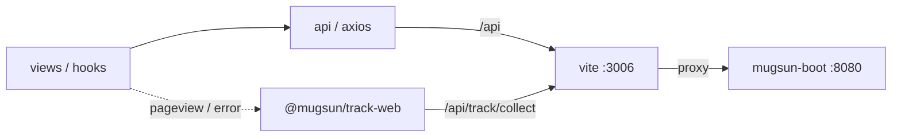

<p align="center">
  
</p>

# mugsun-pc

**中文** | [English](./README_EN.md)

**对接 boot 的管理台：服务端菜单进侧边栏，GIS / 埋点 / AI 按需挂。**  
Vue 3 · Vite · Element Plus；默认权限来自后端，不是再摆一张功能墙。

[文档](https://docs.mugsun.com/pc/) · [快速开始](https://docs.mugsun.com/guide/getting-started) · [演示（即将上线）](https://docs.mugsun.com/demo)


---

## 为什么选它

1. **和 boot 是一条竖切**：菜单、按钮码、`/auth/info` 同源；开发期 `/api` 代理到 `:8080`，无 mock。
2. **可选模块真可关**：`modules/gis` · `modules/track` · `modules/ai` 由 `VITE_ENABLE_*` 控制；设 `false` 不注册路由，删目录可彻底去源码。
3. **埋点看板同仓**：`@mugsun/track-web` 以 `file:../mugsun-track` 接入，采集与看板不另购一套云。

它不是又一个「装上就能卖」的低代码壳；UI 基座衍生自 [art-design-pro](https://github.com/Daymychen/art-design-pro)（MIT），详见 [NOTICE](./NOTICE)。

---

## 最短路径（本地）

前置：Node.js ≥ 20.19、pnpm ≥ 8.8（锁定 `pnpm@11.9.0`）；[mugsun-boot](https://github.com/mugsun/mugsun-boot) 已在 `:8080` 跑着；与 [mugsun-track](https://github.com/mugsun/mugsun-track) **平级** clone（默认开启埋点时需要）。

```bash
# 1. 本地埋点 SDK（file: 依赖，dist 不随仓分发）
pnpm setup:sdk
# 等价：cd ../mugsun-track && pnpm install && pnpm build

# 2. 本仓
pnpm install
pnpm dev
```

打开 http://localhost:3006 （`VITE_PORT`）。`/api/**` 代理到 `.env.development` 的 `VITE_API_PROXY_URL`（默认 `http://localhost:8080`）。登录账号与 boot 一致（默认 `admin` / `123456`）。

`VITE_ENABLE_TRACK=false` 时可跳过 `setup:sdk`。逐步说明：[文档 · 快速开始](https://docs.mugsun.com/guide/getting-started)。

---

## 它长什么样



平级目录约定：

```text
mugsun/
  mugsun-core/
  mugsun-boot/     # :8080
  mugsun-pc/       # 本仓 :3006
  mugsun-track/    # file: 依赖
```

> **截图占位**：登录、系统管理、埋点看板截图就绪后放这里。公网 Demo 见 [演示](https://docs.mugsun.com/demo)。

能力清单、可选模块开关与脚本说明以 [文档](https://docs.mugsun.com/pc/) 和源码为准，本页不堆功能表。

---

## 诚实边界

| 有 | 没有 / 尚未 |
| --- | --- |
| 后端菜单权限 + CRUD / 流程等管理页 | 保证开箱即用的公网 Demo |
| 可选 GIS / 埋点看板 / AI 模块 | 脱离 boot 的独立后端 |
| 开发代理到真实 `:8080` | 内置可替换的完整 mock 层 |

免费开源主线：`boot` · `core` · `pc` · `track`。更多：[docs.mugsun.com](https://docs.mugsun.com/)。

---

## License

[MIT](./LICENSE) · UI 基座致谢见 [NOTICE](./NOTICE)
