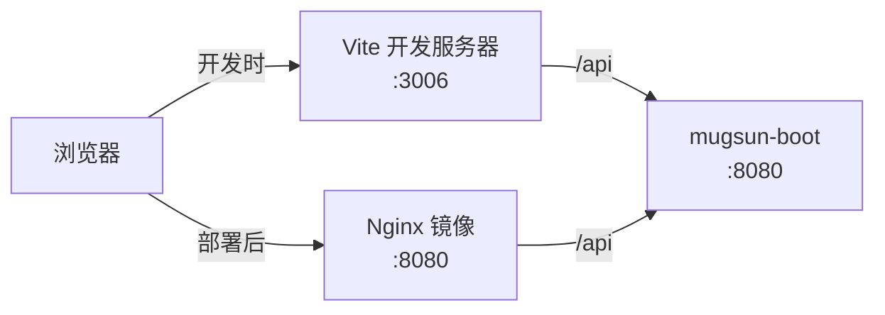

# mugsun-pc

[English](./README_EN.md) | [文档](https://docs.mugsun.com/pc/) | [更新日志](./CHANGELOG.md)

[](https://github.com/mugsun/mugsun-pc/actions/workflows/ci.yml) [](./LICENSE)

mugsun 的管理后台，用 Vue 3 和 Element Plus 编写，后端是 [mugsun-boot](https://github.com/mugsun/mugsun-boot)。

系统管理的页面都已经做好。GIS、埋点看板和 AI 管理页是三个可选模块，构建时可以关掉。

下图是「埋点分析 → 数据概览」页。


## 启动

需要 Node.js 22.13+ 和 pnpm 11.11+。后端要先在 8080 端口启动，做法见 [mugsun-boot 的本地开发](https://github.com/mugsun/mugsun-boot#本地开发)。

```bash
git clone https://github.com/mugsun/mugsun-pc.git && cd mugsun-pc
pnpm install
pnpm dev
```

浏览器会自动打开 <http://localhost:3006>。用 `admin` 和启动后端时设置的初始口令登录。

开发时 `/api` 请求转发到 `http://localhost:8080`。要换地址，改 `.env.development` 里的 `VITE_API_PROXY_URL`。

端口在 `.env` 的 `VITE_PORT` 里。换了端口，后端的 `MUGSUN_FRONT_URL` 也要跟着改，它用于跨域和 OAuth 回跳。

只想看效果时，不需要安装 Node.js。mugsun-boot 的 [Docker 命令](https://github.com/mugsun/mugsun-boot#用-docker-试用)会把管理后台一起启动。

<details>
<summary>联调埋点 SDK 的源码</summary>

默认使用 npm 上的 `@mugsun/track-web`。要换成本地源码，把 [mugsun-track](https://github.com/mugsun/mugsun-track) 克隆到同级目录，然后执行：

```bash
pnpm link ../mugsun-track
```

也可以在 `.npmrc` 里写 `@mugsun/track-web=link:../mugsun-track`，再执行 `pnpm install`。

</details>

## 有哪些页面

| 菜单             | 页面                                                       |
| ---------------- | ---------------------------------------------------------- |
| 系统管理         | 用户、角色和菜单，字典、参数和行政区划，各类日志和服务监控 |
| 工作流           | 流程设计、审批中心和待办工作台                             |
| 低代码           | 代码生成、动态建表和表单设计                               |
| 租户运营         | 租户、套餐和租户数据源                                     |
| 开放平台         | API 密钥、OAuth 客户端和调用日志                           |
| 埋点分析（可选） | 数据概览、漏斗和留存，性能分析、错误监控和会话回放         |
| 地理信息（可选） | 地图、图层和场景。二维用 OpenLayers，三维用 Cesium         |
| AI 中心（可选）  | 大模型配置、知识库和对话记录                               |

界面有中文和英文，有亮色和暗色两套主题。下图是地理信息里的地图页。


## 关闭可选模块

三个开关在 `.env` 里，默认都是 `true`：

```ini
VITE_ENABLE_GIS = true
VITE_ENABLE_TRACK = true
VITE_ENABLE_AI = true
```

改成 `false` 后重新构建，这个模块的路由和插件就不再注册，`modules/` 下对应的目录也可以删掉。

后端也有对应的开关，见 [mugsun-boot 的说明](https://github.com/mugsun/mugsun-boot#只打包需要的模块)。

## 部署

```bash
docker build -t mugsun/pc:local .
docker run -d -p 8088:8080 -e MUGSUN_API_UPSTREAM=http://<后端地址>:8080 mugsun/pc:local
```

镜像里是一个非 root 运行的 Nginx，负责提供静态文件，并把 `/api/xxx` 转发到后端的 `/xxx`。

后端地址在运行时用 `MUGSUN_API_UPSTREAM` 指定，换环境不需要重新构建。其他变量和 CSP 设置见 [Docker 部署](https://docs.mugsun.com/pc/deploy-docker)。

不用 Docker 时，执行 `pnpm build`，把 `dist/` 放到任意静态服务器上，再按上面的规则转发 `/api`。

## 代码结构



| 目录             | 内容                             |
| ---------------- | -------------------------------- |
| `src/`           | 登录鉴权、路由和系统管理页面     |
| `modules/gis/`   | 可选，地图、图层和空间分析       |
| `modules/track/` | 可选，埋点接入管理和分析看板     |
| `modules/ai/`    | 可选，模型、知识库和对话等管理页 |
| `e2e/` `e2e-ui/` | Playwright 测试                  |
| `docker/`        | Nginx 配置和 Compose 文件        |

前端不保存权限数据。侧边栏菜单和按钮权限都由后端的 `/auth/info` 接口返回。

管理后台自己也接了埋点 SDK [@mugsun/track-web](https://github.com/mugsun/mugsun-track)，所以上面的概览页里有它自己的访问数据。

## 常用命令

| 命令                 | 作用                                        |
| -------------------- | ------------------------------------------- |
| `pnpm dev`           | 启动开发服务器                              |
| `pnpm build`         | 类型检查并打包到 `dist/`                    |
| `pnpm test`          | 单元测试，使用 Vitest                       |
| `pnpm test:ui-check` | 界面自检，不需要启动后端                    |
| `pnpm test:e2e`      | 端到端测试，使用 Playwright                 |
| `pnpm lint`          | ESLint 检查                                 |
| `pnpm gen:api`       | 按后端的 OpenAPI 生成接口类型，后端要在运行 |

界面自检在 CI 里必须通过，检查内容见 [UI 自检](https://docs.mugsun.com/pc/ui-check)。

## 目前的限制

- 必须配合 mugsun-boot 使用，没有独立的 mock 后端。
- 没有公网演示环境。

## 相关仓库

| 仓库 | 说明 |
| --- | --- |
| [mugsun-boot](https://github.com/mugsun/mugsun-boot) | 后端，管理后台的所有接口都来自它 |
| [mugsun-track](https://github.com/mugsun/mugsun-track) | 浏览器埋点 SDK，以 npm 包的形式引入 |
| [mugsun-docs](https://github.com/mugsun/mugsun-docs) | 文档站 [docs.mugsun.com](https://docs.mugsun.com/) 的源码 |

## 致谢

界面在 [art-design-pro](https://github.com/Daymychen/art-design-pro)（MIT）的基础上修改，许可声明见 [NOTICE](./NOTICE)。

## 参与贡献

提交前请读[贡献指南](./CONTRIBUTING.md)。安全问题请按 [SECURITY.md](https://github.com/mugsun/.github/blob/main/SECURITY.md) 私下报告，不要开公开 Issue。

## 许可

MIT，见 [LICENSE](./LICENSE)。
