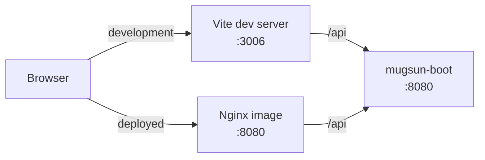

# mugsun-pc

[中文](./README.md) | [Docs](https://docs.mugsun.com/en/pc/) | [Changelog](./CHANGELOG.md)

[](https://github.com/mugsun/mugsun-pc/actions/workflows/ci.yml) [](./LICENSE)

The admin console of mugsun, written in Vue 3 and Element Plus. Its backend is [mugsun-boot](https://github.com/mugsun/mugsun-boot).

The system administration pages are all there. GIS, the analytics dashboards and the AI pages are three optional modules that you can switch off at build time.

The screenshot below is the Tracking > Overview page.


## Run it

You need Node.js 22.13+ and pnpm 11.11+. Start the backend on port 8080 first, as described in [Local development](https://github.com/mugsun/mugsun-boot/blob/main/README_EN.md#local-development) for mugsun-boot.

```bash
git clone https://github.com/mugsun/mugsun-pc.git && cd mugsun-pc
pnpm install
pnpm dev
```

Your browser opens <http://localhost:3006>. Sign in as `admin` with the initial password you set when starting the backend.

During development, `/api` requests are forwarded to `http://localhost:8080`. To use another address, change `VITE_API_PROXY_URL` in `.env.development`.

The port is `VITE_PORT` in `.env`. If you change it, change `MUGSUN_FRONT_URL` on the backend as well; it is used for CORS and OAuth redirects.

If you only want a look, you don't need Node.js. The [Docker commands](https://github.com/mugsun/mugsun-boot/blob/main/README_EN.md#try-it-with-docker) in mugsun-boot start the admin console too.

<details>
<summary>Working on the tracking SDK source</summary>

The console uses `@mugsun/track-web` from npm by default. To use local source instead, clone [mugsun-track](https://github.com/mugsun/mugsun-track) next to this repository and run:

```bash
pnpm link ../mugsun-track
```

Or add `@mugsun/track-web=link:../mugsun-track` to `.npmrc` and run `pnpm install`.

</details>

## Pages

| Menu | Pages |
| --- | --- |
| System settings | Users, roles and menus; dictionaries, parameters and regions; logs and server monitoring |
| Workflow | Flow designer, approval center and todo workbench |
| Low-code | Code generator, dynamic tables and form designer |
| Tenant operations | Tenants, packages and tenant datasources |
| Open platform | API keys, OAuth clients and call logs |
| Tracking (optional) | Overview, funnels and retention; performance, error monitoring and session replay |
| GIS (optional) | Map, layers and scenes. 2D uses OpenLayers and 3D uses Cesium |
| AI center (optional) | Models, knowledge bases and conversations |

The interface comes in Chinese and English, with a light and a dark theme. Below is the session replay page.


## Switch off optional modules

The three switches are in `.env` and default to `true`:

```ini
VITE_ENABLE_GIS = true
VITE_ENABLE_TRACK = true
VITE_ENABLE_AI = true
```

Set one to `false` and rebuild. The routes and plugins of that module are no longer registered, and you can delete its directory under `modules/`.

The backend has matching switches, described in [mugsun-boot](https://github.com/mugsun/mugsun-boot/blob/main/README_EN.md#build-only-the-modules-you-need).

## Deploy

```bash
docker build -t mugsun/pc:local .
docker run -d -p 8088:8080 -e MUGSUN_API_UPSTREAM=http://<backend-host>:8080 mugsun/pc:local
```

The image runs Nginx as a non-root user. It serves the static files and forwards `/api/xxx` to `/xxx` on the backend.

The backend address is set at runtime with `MUGSUN_API_UPSTREAM`, so one image works in every environment. Other variables and the CSP settings are covered in [Docker deployment](https://docs.mugsun.com/en/pc/deploy-docker).

Without Docker, run `pnpm build`, put `dist/` on any static server and forward `/api` by the same rule.

## Layout



| Directory        | Contents                                                      |
| ---------------- | ------------------------------------------------------------- |
| `src/`           | Sign-in, routing and the system administration pages          |
| `modules/gis/`   | Optional: map, layers and spatial analysis                    |
| `modules/track/` | Optional: tracking setup and analytics dashboards             |
| `modules/ai/`    | Optional: pages for models, knowledge bases and conversations |
| `e2e/` `e2e-ui/` | Playwright tests                                              |
| `docker/`        | Nginx configuration and Compose files                         |

The frontend stores no permission data. Sidebar menus and button permissions both come from the backend's `/auth/info` endpoint.

The console itself is instrumented with the tracking SDK, [@mugsun/track-web](https://github.com/mugsun/mugsun-track). That is why the overview page above already shows its own traffic.

## Commands

| Command | What it does |
| --- | --- |
| `pnpm dev` | Starts the dev server |
| `pnpm build` | Type-checks and builds into `dist/` |
| `pnpm test` | Unit tests with Vitest |
| `pnpm test:ui-check` | UI self-check; needs no backend |
| `pnpm test:e2e` | End-to-end tests with Playwright |
| `pnpm lint` | ESLint |
| `pnpm gen:api` | Generates API types from the backend's OpenAPI spec; the backend must be running |

The UI self-check must pass in CI. What it checks is described in [UI self-check](https://docs.mugsun.com/en/pc/ui-check).

## Current limits

- It only works with mugsun-boot. There is no standalone mock backend.
- There is no public demo.

## Related repositories

| Repository | What it is |
| --- | --- |
| [mugsun-boot](https://github.com/mugsun/mugsun-boot) | The backend. Every API the console calls comes from it |
| [mugsun-track](https://github.com/mugsun/mugsun-track) | The browser tracking SDK, used here as an npm package |
| [mugsun-docs](https://github.com/mugsun/mugsun-docs) | Source of the documentation site, [docs.mugsun.com](https://docs.mugsun.com/en/) |

## Credits

The interface is derived from [art-design-pro](https://github.com/Daymychen/art-design-pro) (MIT). The licence notice is in [NOTICE](./NOTICE).

## Contributing

Read the [contributing guide](https://github.com/mugsun/.github/blob/main/CONTRIBUTING_EN.md) before you send a change. Report security issues privately as described in [SECURITY.md](https://github.com/mugsun/.github/blob/main/SECURITY.md). Please do not open a public issue.

## License

MIT, see [LICENSE](./LICENSE).
