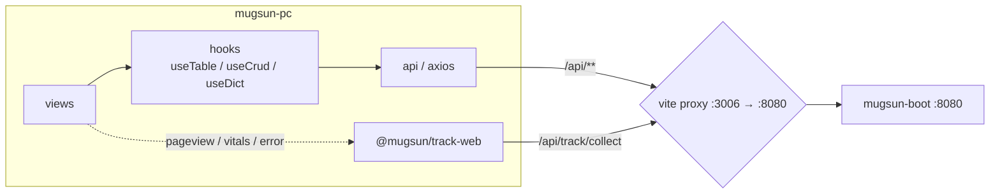

# mugsun-pc

English | [简体中文](./README.md)

PC admin frontend for the mugsun platform. Built with Vue 3 + TypeScript + Vite + Element Plus against [mugsun-boot](https://github.com/mugsun/mugsun-boot): server-driven menus and button permissions, system admin, low-code forms, workflow, monitoring, open platform, and tenant ops. GIS, analytics dashboards, and the AI assistant ship as **optional modules** — not a catch-all “low-code everything” pitch.

Docs: [docs.mugsun.com](https://docs.mugsun.com/) · Site: [mugsun.com](https://mugsun.com)

[](https://vuejs.org/)
[](https://www.typescriptlang.org/)
[](https://vite.dev/)
[](https://element-plus.org/)
[](https://pnpm.io/)
[](./LICENSE)

## Features (from source)

| Area | What ships |
| --- | --- |
| Server menus & permissions | `VITE_ACCESS_MODE=backend`; sidebar from backend menu tree; `v-perm` / `hasPerm` gate on `/auth/info` button codes |
| CRUD composables | `useTable` / `useCrud` / `useDict`, persisted table columns (`src/hooks/core`) |
| Low-code forms | `@form-create/designer` + `@form-create/element-ui` |
| Workflow | Definitions, todos, running instances, graph (`src/views/system/flow-*`) |
| Monitoring & open platform | Online users, cache, logs; OAuth client / consent / debug; API keys |
| Tenant ops | Tenants, packages, datasources (`tenant*`) |
| Self-monitoring analytics | Optional `modules/track` wiring `@mugsun/track-web` (API monitor, visual track, replay, geo) |
| GIS | Optional `modules/gis` (OpenLayers / Cesium, …) |
| AI assistant | Optional `modules/ai` (models, knowledge, chat, billing, … + global drawer) |
| Realtime messaging | WebSocket `/api/ws/message?token=…` (`src/utils/socket`); dev proxy `ws: true` |
| Login transport | Passwords encrypted with SM2 before submit (`src/utils/gm.ts`) |
| Bilingual UI | vue-i18n — `src/locales/langs/{zh,en}.json` |
| Contract sync | `pnpm gen:api` from `http://localhost:8080/v3/api-docs` → `openapi.d.ts` |
| E2E | Playwright on `http://localhost:3007` with real captcha (Redis-backed answers) |

## Architecture

Pages do not call HTTP directly. Traffic flows views → hooks → api → backend; the analytics SDK reports through the same `/api` proxy:



Clone sibling repos **side by side** (this app depends on the SDK via `file:../mugsun-track`):

```
mugsun/
├── mugsun-core
├── mugsun-boot      # :8080
├── mugsun-pc        # this repo
└── mugsun-track     # @mugsun/track-web sources
```

## Quick start

**Requires** Node.js ≥ 20.19 and pnpm ≥ 8.8 (`packageManager` pins `pnpm@11.9.0`). Start Postgres / Redis and [mugsun-boot](https://github.com/mugsun/mugsun-boot) on `:8080` first.

`@mugsun/track-web` is declared as **`file:../mugsun-track`** — it is **not** resolved from npm in this repo. The SDK’s `dist/` is not committed; a bare `pnpm install && pnpm dev` fails until you build the SDK once (skip if `VITE_ENABLE_TRACK=false`):

```bash
# 1. Build the local analytics SDK
cd ../mugsun-track
pnpm install && pnpm build

# Or from mugsun-pc:
# pnpm setup:sdk

# 2. Install and run this app
cd ../mugsun-pc
pnpm install
pnpm dev
```

Dev server uses `VITE_PORT` from `.env` (**3006**) and opens the browser. `/api/**` proxies to `VITE_API_PROXY_URL` in `.env.development` (default `http://localhost:8080`). No mock layer.

## Optional modules

Sources live under `modules/gis`, `modules/track`, and `modules/ai`. Toggles in root `.env` (enabled unless set to `false`):

```bash
VITE_ENABLE_GIS=true
VITE_ENABLE_TRACK=true
VITE_ENABLE_AI=true
```

`false` skips route/plugin registration; delete the module directory to remove sources entirely. Aliases and Cesium asset copy: `vite.config.ts`.

## Scripts

| Command | Purpose |
| --- | --- |
| `pnpm dev` | Dev server (`vite --open`, port 3006) |
| `pnpm dev:e2e` | Isolated instance on **3007** for Playwright |
| `pnpm setup:sdk` | `install` + `build` in `../mugsun-track` |
| `pnpm build` | `vue-tsc --noEmit` + production build |
| `pnpm serve` | `vite preview` |
| `pnpm gen:api` | Regenerate `openapi.d.ts` from backend OpenAPI |
| `pnpm test` / `pnpm test:watch` | Vitest |
| `pnpm test:e2e` | Playwright (serial, `workers: 1`) |
| `pnpm lint` / `pnpm fix` | ESLint |
| `pnpm lint:prettier` / `pnpm lint:stylelint` | Format / styles |
| `pnpm commit` | git-cz |
| `pnpm clean:dev` | Strip template sample routes/pages |

## End-to-end tests

```bash
# Prerequisites: mugsun-boot(:8080), containers mugsun-pg / mugsun-redis
pnpm setup:sdk
pnpm dev:e2e          # terminal A
pnpm test:e2e         # terminal B
```

Auth flows read captcha answers via `docker exec <redis> redis-cli`. Override with `E2E_REDIS_CONTAINER` (default `mugsun-redis`), `E2E_REDIS_DB` (default `3`), `E2E_BASE_URL`. Some suites also expect PowerJob Server (see `playwright.config.ts`).

## Layout

```
src/
├── api/
├── components/
├── directives/      # v-perm, …
├── hooks/core/      # useTable / useCrud / useDict, …
├── locales/langs/
├── plugins/         # echarts, track façade
├── router/
├── store/modules/
├── types/api/       # openapi.d.ts (generated)
├── utils/           # http, gm (SM2), socket, …
└── views/
modules/
├── gis/
├── track/
└── ai/
```

## Related

| Repo | Role |
| --- | --- |
| [mugsun-boot](https://github.com/mugsun/mugsun-boot) | Backend service |
| [mugsun-core](https://github.com/mugsun/mugsun-core) | Backend kernel |
| [mugsun-track](https://github.com/mugsun/mugsun-track) | Web analytics SDK (`file:` dep here) |
| [mugsun-docs](https://github.com/mugsun/mugsun-docs) | Docs → [docs.mugsun.com](https://docs.mugsun.com/) |

## Contributing

Issues and PRs welcome. Commit style: [.github/COMMIT_CONVENTION.md](.github/COMMIT_CONVENTION.md).

## Attribution

The UI shell is derived from [art-design-pro](https://github.com/Daymychen/art-design-pro) (MIT), Copyright (c) 2025 SuperManTT. See [NOTICE](./NOTICE) and [LICENSE](./LICENSE).

## License

[MIT License](./LICENSE)
