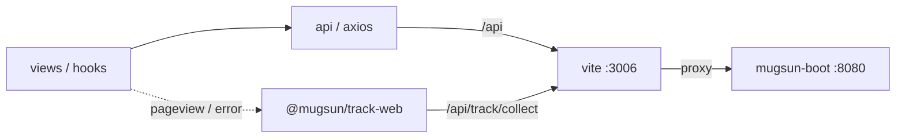

<p align="center">
  
</p>

# mugsun-pc

[简体中文](./README.md) | English

**Admin UI for boot: server menus into the sidebar; GIS / analytics / AI opt-in.**  
Vue 3 · Vite · Element Plus — permissions from the API, not another feature wall.

[Docs](https://docs.mugsun.com/en/pc/) · [Getting started](https://docs.mugsun.com/en/guide/getting-started) · [Demo (coming soon)](https://docs.mugsun.com/en/demo)


---

## Why this

1. **Same vertical as boot** — menus, button codes, `/auth/info` from one backend; `/api` proxies to `:8080` in dev, no mock.
2. **Optional modules are real switches** — `modules/gis` · `modules/track` · `modules/ai` via `VITE_ENABLE_*`; `false` skips routes, deleting the folder removes the code.
3. **Analytics dashboard in-repo** — `@mugsun/track-web` via `file:../mugsun-track`; collect + board without a second SaaS bill.

Not a “ship-and-sell” low-code shell. UI base derives from [art-design-pro](https://github.com/Daymychen/art-design-pro) (MIT); see [NOTICE](./NOTICE).

---

## Shortest local path

Needs Node.js ≥ 20.19, pnpm ≥ 8.8 (`packageManager` locks `pnpm@11.9.0`); [mugsun-boot](https://github.com/mugsun/mugsun-boot) on `:8080`; [mugsun-track](https://github.com/mugsun/mugsun-track) as a **sibling** (required when track is enabled, the default).

```bash
pnpm setup:sdk   # builds ../mugsun-track (file: dep; dist not shipped)
pnpm install
pnpm dev
```

Open http://localhost:3006 (`VITE_PORT`). `/api/**` → `VITE_API_PROXY_URL` (default `http://localhost:8080`). Login matches boot (default `admin` / `123456`).

Skip `setup:sdk` when `VITE_ENABLE_TRACK=false`. Walkthrough: [docs](https://docs.mugsun.com/en/guide/getting-started).

---

## Shape



> **Screenshot placeholder** — login / system / analytics shots go here when ready. See [Demo](https://docs.mugsun.com/en/demo).

Module flags and scripts live in [docs](https://docs.mugsun.com/en/pc/) and source — this README is not a feature wall.

---

## Honest boundaries

| Includes | Does not / not yet |
| --- | --- |
| Backend menus + admin pages (CRUD, flow, …) | A live public demo |
| Optional GIS / track dashboard / AI | A backend without boot |
| Dev proxy to real `:8080` | A full replaceable mock layer |

Free OSS line: `boot` · `core` · `pc` · `track`. More: [docs.mugsun.com](https://docs.mugsun.com/en/).

---

## License

[MIT](./LICENSE) · UI-base credit in [NOTICE](./NOTICE)
